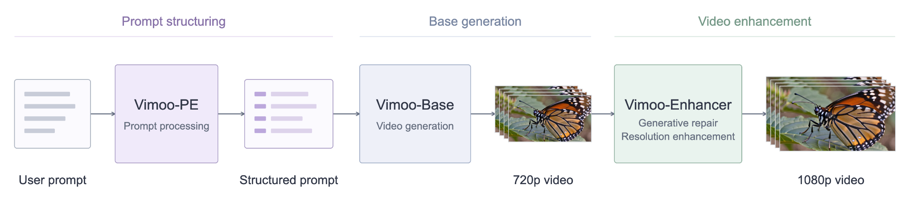
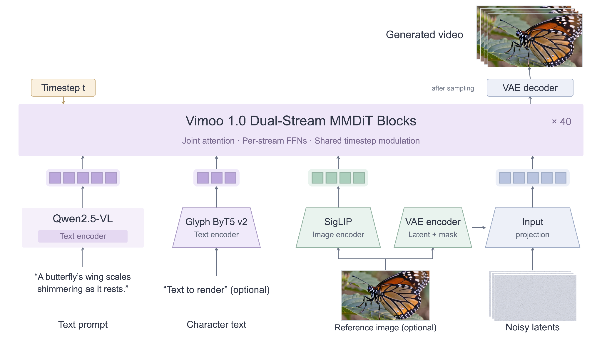

#  Vimoo 1.0

[](https://vimoo.ai)
[](https://huggingface.co/Vimoo-AI)
[](https://github.com/Vimoo-AI/ComfyUI-Vimoo)
[](https://github.com/Vimoo-AI/Vimoo-1.0-MLX)
[](https://vimoo.ai/research)

Vimoo 1.0 is an open-source video generation model family for text-to-video (T2V) and image-to-video (I2V), built on a dual-stream MMDiT. Its lightweight variant, Vimoo 1.0 - Lite, handles both tasks in a single model for faster inference. This repository provides Python inference examples.

- **Diffusers Pipeline**: [Quick Start](#-quick-start)
- **ComfyUI Workflows**: [ComfyUI-Vimoo](https://github.com/Vimoo-AI/ComfyUI-Vimoo) · [ComfyUI Weights](https://huggingface.co/Vimoo-AI/Vimoo-1.0-ComfyUI) · [Lite ComfyUI Weights](https://huggingface.co/Vimoo-AI/Vimoo-1.0-Lite-ComfyUI)
- **MLX (Apple Silicon)**: [Vimoo-1.0-MLX](https://github.com/Vimoo-AI/Vimoo-1.0-MLX) · [MLX Weights](https://huggingface.co/Vimoo-AI/Vimoo-1.0-Lite-MLX)

## 🔥 News

- **[2026-10]** Release Vimoo 1.0: T2V / I2V models, Diffusers inference examples and ComfyUI workflows.

<a id="showcase"></a>

## 🎬 Showcase

https://github.com/user-attachments/assets/47b2c41e-7d9e-46c6-a632-bfa122438284

## 🌐 Online API

Use Vimoo 1.0 directly via API. https://vimoo.ai

The model API includes three use cases: Vimoo 1.0, Vimoo 1.0 - Ecom, and Vimoo 1.0 - Lite.

<table>
  <thead>
    <tr>
      <th align="left">Repository</th>
      <th align="left">Task</th>
      <th align="left">Use case</th>
    </tr>
  </thead>
  <tbody>
    <tr>
      <td rowspan="2">Vimoo-1.0</td>
      <td>Text-to-Video</td>
      <td>Turn text prompts into videos. Describe scenes, stories, camera moves, and mood; the API returns cinematic, story-driven video. Supports 5-second clips at 720P.</td>
    </tr>
    <tr>
      <td>Image-to-Video</td>
      <td>Animate images with reference images and text prompts. Describe emotions, storylines, and camera moves; the API returns video that keeps the reference image's look and subject consistency.</td>
    </tr>
    <tr>
      <td>Vimoo-1.0-Ecom</td>
      <td>E-Commerce Video</td>
      <td>Create e-commerce videos from product reference images. Combine 1–9 images with optional titles, descriptions, and selling points to make 20-second, 9:16, 720P videos for product showcases and promotions.</td>
    </tr>
    <tr>
      <td>Vimoo-1.0-Lite</td>
      <td>Text/Image-to-Video</td>
      <td>Generates videos from text prompts, with an optional first-frame image. It prioritizes speed and lower resource usage, outputting 5-second 720p video.</td>
    </tr>
  </tbody>
</table>

## 🗺️ System Overview



The complete Vimoo system consists of the following three modules:

- **Vimoo-PE:** We developed a dedicated system that deeply interprets and refines incoming multimodal instructions, then transforms them into a format that Vimoo can easily process for generation. Vimoo-PE plays a crucial role in determining the quality of the final output; we highly recommend integrating it into your generation pipeline—or following the '[Prompt Guide](https://vimoo.ai/vimoo-docs/api#prompts)' to build your own prompt system.
- **Vimoo-Base:** Generates 720p video based on the Vimoo-PE output.
- **Vimoo-Enhancer:** Feeds the 720p video to regenerate the output at 1080p resolution. It combines the resolution and clarity enhancement associated with generative repair of defects in appearance and motion, enabling it to produce high-resolution outputs with more accurate details and greater visual fidelity.

To help the community deploy Vimoo correctly, we provide three approaches.

- **Open Platform API:** Since Vimoo consists of three modules: Vimoo-PE, Vimoo-Base, and Vimoo-Enhancer, we offer the [Open Platform API](https://vimoo.ai/) to support full end-to-end invocation of the complete pipeline, while the Enhancer is optional.
- **OpenSource:** We have open-sourced the Vimoo-Base model to enable validation of 720p output. For better results, you can refer to the '[Prompt Guide](https://vimoo.ai/vimoo-docs/api#prompts)' section, which provides a detailed tutorial to help the community develop their own prompting systems. You may also further call the standalone Enhancer API to obtain high-definition 1080P results.
- **Run Locally:** We provide locally deployable models, including ComfyUI and MLX versions, to support running Vimoo-Base on lower-end devices. Here too, the '[Prompt Guide](https://vimoo.ai/vimoo-docs/api#prompts)' section is essential.

In addition, we provide an e-commerce video generation API, specifically designed for product and advertising video generation. It follows the same three-stage pipeline and outputs a 20-second story-driven e-commerce video.

## 📦 Model Zoo

Vimoo 1.0 comes in two models, Vimoo 1.0 and Vimoo 1.0 - Lite. Each Hugging Face repository packages one of them for one runtime:

<table>
  <thead>
    <tr>
      <th align="left">Model</th>
      <th align="left">Hugging Face</th>
      <th align="left">Inference code</th>
      <th align="left">Description</th>
    </tr>
  </thead>
  <tbody>
    <tr>
      <td rowspan="2"><strong>Vimoo 1.0</strong><br>≈11.7B per model</td>
      <td><a href="https://huggingface.co/Vimoo-AI/Vimoo-1.0"></a></td>
      <td><a href="https://github.com/Vimoo-AI/Vimoo-1.0"></a></td>
      <td>T2V and I2V for the Vimoo Diffusers fork</td>
    </tr>
    <tr>
      <td><a href="https://huggingface.co/Vimoo-AI/Vimoo-1.0-ComfyUI"></a></td>
      <td><a href="https://github.com/Vimoo-AI/ComfyUI-Vimoo"></a></td>
      <td>T2V, I2V and their Distilled versions for ComfyUI</td>
    </tr>
    <tr>
      <td rowspan="3"><strong>Vimoo 1.0 - Lite</strong><br>≈9.5B</td>
      <td><a href="https://huggingface.co/Vimoo-AI/Vimoo-1.0-Lite"></a></td>
      <td><a href="https://github.com/Vimoo-AI/Vimoo-1.0"></a></td>
      <td>TI2V for the Vimoo Diffusers fork</td>
    </tr>
    <tr>
      <td><a href="https://huggingface.co/Vimoo-AI/Vimoo-1.0-Lite-ComfyUI"></a></td>
      <td><a href="https://github.com/Vimoo-AI/ComfyUI-Vimoo"></a></td>
      <td>TI2V and TI2V Distilled for ComfyUI</td>
    </tr>
    <tr>
      <td><a href="https://huggingface.co/Vimoo-AI/Vimoo-1.0-Lite-MLX"></a></td>
      <td><a href="https://github.com/Vimoo-AI/Vimoo-1.0-MLX"></a></td>
      <td>TI2V Distilled for MLX on Apple Silicon</td>
    </tr>
  </tbody>
</table>

Each ComfyUI repository includes its checkpoints, distilled LoRA adapters, Qwen text encoder, SigLIP vision encoder and VAE. Distilled models are available only for ComfyUI and MLX. Vimoo-1.0 T2V Distilled and I2V Distilled use different base checkpoints from Vimoo-1.0 T2V and I2V; download each task's matching base and adapter listed in the [ComfyUI guide](https://github.com/Vimoo-AI/ComfyUI-Vimoo#download-weights). The Vimoo-1.0 T2V Distilled, Vimoo-1.0 I2V Distilled and Vimoo-1.0-Lite TI2V Distilled adapters are not interchangeable. Parameters count the video denoiser only.

## 🚀 Quick Start

### Installation

Use Linux with an NVIDIA CUDA GPU, Python 3.10 or later (`python3 --version`), and PyTorch 2.9.0 with CUDA 13.0 (`cu130`). Use an NVIDIA driver compatible with CUDA 13.0. On Debian/Ubuntu, install virtual environment support with `sudo apt install python3-venv`. The commands below pin PyTorch and torchvision; other dependency ranges are listed in [requirements.txt](requirements.txt). The supplied examples default to PyTorch SDPA, which needs no additional attention package. Install an optional backend only when selecting it; see [Runtime Options](#-runtime-options). Memory needs depend on the model, output size, frame count, offload and VAE decoding settings.

```bash
git clone https://github.com/Vimoo-AI/Vimoo-1.0.git
cd Vimoo-1.0
python3 -m venv .venv
source .venv/bin/activate
python3 -m pip install "torch==2.9.0+cu130" "torchvision==0.24.0+cu130" --index-url https://download.pytorch.org/whl/cu130
python3 -m pip install -r requirements.txt
python3 -m pip install "git+https://github.com/Vimoo-AI/diffusers.git"
```

### Download weights

Download the Diffusers repository for your model into `./models/`. The ComfyUI and MLX repositories are not used by these examples. The `hf` command is installed with `huggingface_hub` from the requirements.

```bash
hf download Vimoo-AI/Vimoo-1.0 --local-dir ./models/Vimoo-1.0                     # T2V and I2V
hf download Vimoo-AI/Vimoo-1.0-Lite --local-dir ./models/Vimoo-1.0-Lite           # Lite TI2V
```

Vimoo-1.0 stores separate T2V and I2V Transformers. To download one task only, add `--exclude "transformer_i2v/*"` for T2V or `--exclude "transformer/*"` for I2V.

Both repositories contain the Vimoo Transformers and sampling configurations. On the first run, Diffusers downloads Qwen2.5-VL-7B-Instruct, the Wan 2.2 VAE and, for I2V, SigLIP from Hugging Face at the revisions recorded in `modular_model_index.json`. For offline use, run once with network access, then set `HF_HUB_OFFLINE=1`.


#### ByT5 encoder

Vimoo uses [Glyph-SDXL-v2](https://huggingface.co/nlpcvcode/Glyph-SDXL-v2) as its ByT5 encoder. Download the encoder and the base ByT5 configuration and tokenizer, then convert the files for inference:

```bash
hf download nlpcvcode/Glyph-SDXL-v2 --revision a5aac7f492e85819208e7ed14aa4402d9c0b1b65 --include "checkpoints/byt5_model.pt" "assets/color_idx.json" "assets/multilingual_10-lang_idx.json" --local-dir ./glyph-source/Glyph-SDXL-v2
hf download google/byt5-small --revision 68377bdc18a2ffec8a0533fef03b1c513a4dd49d --include "config.json" "tokenizer_config.json" "special_tokens_map.json" --local-dir ./glyph-source/byt5-small
python3 tools/convert_byt5.py --source-dir ./glyph-source/Glyph-SDXL-v2 --base-dir ./glyph-source/byt5-small --output ./models/Vimoo-1.0 --format diffusers
```

For Vimoo-1.0-Lite, set `--output` to `./models/Vimoo-1.0-Lite`.

### Inference examples

Each file in `examples/` directly shows model loading, inputs, inference and export.

| **Scenarios** | **Example** | **Input** |
| --- | --- | --- |
| Vimoo-1.0 T2V | [vimoo_1_0_t2v.py](https://github.com/Vimoo-AI/Vimoo-1.0/blob/main/examples/vimoo_1_0_t2v.py) | Text |
| Vimoo-1.0 I2V | [vimoo_1_0_i2v.py](https://github.com/Vimoo-AI/Vimoo-1.0/blob/main/examples/vimoo_1_0_i2v.py) | Text + image |
| Vimoo-1.0-Lite TI2V · T2V | [vimoo_1_0_lite_ti2v.py](https://github.com/Vimoo-AI/Vimoo-1.0/blob/main/examples/vimoo_1_0_lite_ti2v.py) | Text |
| Vimoo-1.0-Lite TI2V · I2V | [vimoo_1_0_lite_ti2v.py](https://github.com/Vimoo-AI/Vimoo-1.0/blob/main/examples/vimoo_1_0_lite_ti2v.py) | Text + image |

Run from the repository root, replacing the image with your own file:

```bash
# Vimoo-1.0
python3 examples/vimoo_1_0_t2v.py --model ./models/Vimoo-1.0 --prompt 'A young woman in a red coat walks through a snowy city street and looks up at the falling snow.' --output t2v.mp4
python3 examples/vimoo_1_0_i2v.py --model ./models/Vimoo-1.0 --prompt 'The dog shakes its whole body, then sits back down in the same spot. The camera remains fixed throughout.' --image dog.png --output i2v.mp4

# Vimoo-1.0-Lite: --image selects I2V; omit it for T2V
python3 examples/vimoo_1_0_lite_ti2v.py --model ./models/Vimoo-1.0-Lite --prompt 'A young woman in a red coat walks through a snowy city street and looks up at the falling snow.' --output lite-t2v.mp4
python3 examples/vimoo_1_0_lite_ti2v.py --model ./models/Vimoo-1.0-Lite --prompt 'The dog shakes its whole body, then sits back down in the same spot. The camera remains fixed throughout.' --image dog.png --output lite-i2v.mp4

```

The examples accept `--model`, `--prompt`, `--output` and `--attention-backend`, plus `--image` for image input. Attention defaults to `sdpa`; run the selected file with `--help` to see its arguments. The Lite example selects I2V when `--image` is supplied and T2V when it is omitted. The default output is `vimoo.mp4`, at 1280 × 720 with 121 frames at 24 fps. Generation settings are set in each Python file; start with the matching model's defaults. Each example shows the Python API calls for its task.

## 🔧 Runtime Options

- **Offload:** Use `ComponentsManager.enable_auto_cpu_offload(...)`, or the supported Diffusers group-offload APIs, to move inactive components out of GPU memory.
- **Attention:** The CLI defaults to `--attention-backend sdpa`. Choose `fa2`, `fa3`, `fa4` or `sage` after installing that backend's dependencies below. Python integrations use `pipe.transformer.set_attention_backend(...)`; SDPA uses `"native"`.
- **Compilation:** Optional model compilation is configured through Python; install it before offload hooks where indicated by the example.
- **VAE tiling:** Use `vae_tiling=True` where supported to reduce decode memory. Placement, attention and tiling choices can affect latency, memory and output.
- **LoRA:** Python integrations can load matching Transformer adapters with `load_lora_weights(...)`.

Attention is selected with `--attention-backend`; offload, compilation, VAE tiling and LoRA options are configured through the Python API in the selected example. Width and height must be divisible by 16 and frame counts must be `4n + 1`; Vimoo-1.0-Lite TI2V requires more than one frame.

For an optional attention backend, install its dependency in the inference environment:

For source builds, install CUDA Toolkit 13.0, Git and a C++ compiler. Select the
Toolkit before running the installation command (adjust the path if installed elsewhere):

```bash
export CUDA_HOME=/usr/local/cuda-13.0
export PATH="$CUDA_HOME/bin:$PATH"
nvcc --version
python3 -c "import torch; print(torch.__version__, torch.version.cuda)"
```

`nvcc` must report release `13.0`, and PyTorch must report `2.9.0+cu130` and `13.0`.
Rebuild installed CUDA extensions after changing the PyTorch/CUDA build.

| CLI value | Optional dependency |
|---|---|
| `fa2` | `python3 -m pip install "flash-attn>=2.6.3" --no-build-isolation`; prepare build dependencies from the [installation guide](https://github.com/Dao-AILab/flash-attention#installation-and-features) |
| `fa3` | Build the [FlashAttention Hopper implementation](https://github.com/Dao-AILab/flash-attention/tree/main/hopper), which provides `flash_attn_interface` |
| `fa4` | `python3 -m pip install flash-attn-4==4.0.0b30` |
| `sage` | Build SageAttention 2.2.0 from pinned source: `python3 -m pip install "git+https://github.com/thu-ml/SageAttention.git@eb615cf6cf4d221338033340ee2de1c37fbdba4a" --no-build-isolation`; see the [installation guide](https://github.com/thu-ml/SageAttention/tree/eb615cf6cf4d221338033340ee2de1c37fbdba4a#installation) |

Then add, for example, `--attention-backend fa4` to the selected command. Source builds need the matching CUDA Toolkit and build tools. Missing optional dependencies produce an error for the selected backend. The CLI uses installed kernels; FA2/FA3 do not download Hub kernels automatically.

For SageAttention 2.2.0 on Hopper/SM90, apply the [upstream fake-handler fix](https://github.com/thu-ml/SageAttention/commit/d9704247a5139ab4c03bf7fc6b35cc0e2cbb5ea4) before generation and restart Python.

## 📝 Prompting Guide

**Use English prompts.** The current open-source models have been validated only with English prompts. Generation quality and prompt adherence in other languages have not been validated. We recommend translating prompts into English before generation.

**Write clear, detailed prompts.** Specific descriptions of the subject, scene, action sequence, and camera movement can help produce results that better match your intent than short, vague prompts. See the [Prompt Guide](https://vimoo.ai/vimoo-docs/api#prompts) for structure and examples, and focus on relevant, consistent visual details.

The Prompt Guide describes automatic prompt enhancement in the hosted service. Local examples use your input prompt directly; follow the guide's writing structure and examples when preparing prompts.

## 📖 Technical Architecture

Vimoo 1.0 uses a 40-block dual-stream MMDiT backbone. Joint attention connects the video and conditioning streams, combining prompt semantics, in-video text and optional reference-image features. A Wan 2.2 VAE encodes and decodes the video, while flow matching generates video latents.

### Architecture Diagram



Vimoo-1.0-Lite merges each 2 × 2 spatial region into one video token, reducing sequence length to one quarter while preserving the temporal axis. The fine spatial grid is restored before output projection. Distilled models combine their base Transformer with a matching LoRA adapter.

### Inference components

| Component | Role |
|---|---|
| Diffusers `ModularPipeline` | Load the selected task and compose the generation components |
| Vimoo Transformer | Video generation backbone; select the model for the task |
| Qwen text encoder | Encode the prompt |
| Glyph text encoder and extended tokenizer | Encode quoted in-video text |
| SigLIP vision encoder | Encode the reference image for I2V |
| Video VAE | Encode image conditions and decode video latents |
| LoRA adapter | Apply a matching Transformer adapter through the Python API |

The model index lists component locations and upstream revisions.

### Highlights

- **Prompt adherence:** a dedicated text encoder turns prompts into precise generation conditions. An optional prompt enhancer can add visual, cinematic, temporal, and contextual detail, or be disabled to preserve the original wording.
- **Cinematic visual quality:** training on carefully curated aesthetic data, with detailed annotations for lighting, composition, contrast, color grading, and more, enables precise control over cinematic styles and a wide range of aesthetic preferences.
- **Advanced motion generation:** a larger and more diverse training corpus improves generalization across motion, semantics, and visual aesthetics, delivering leading performance among open-source and proprietary video generation models.
- **E-commerce video generation:** by faithfully highlighting product selling points and features while preserving fine-grained product details, it ensures strong product consistency across frames, delivering reliable and visually coherent results that meet the practical demands of e-commerce content creation.
- **Efficient high-definition generation:** the lightweight variant uses 32×32×4 spatiotemporal compression and supports T2V and I2V at 720p and 24 fps.


## 📈 Evaluation & Benchmarks

### Generation Quality

**Vimoo-VBench** is a human evaluation developed by the Vimoo team, with 500 prompts covering advertising, social media, storytelling, education and entertainment. T2V is evaluated for instruction following, frame aesthetics, visual quality and motion; I2V also measures image-video consistency.

The tables compare model families on this evaluation set. Results for individual checkpoints depend on their weights and generation settings.

**T2V human evaluation (%)**

<table>
  <thead>
    <tr>
      <th rowspan="2" align="left">Metric</th>
      <th colspan="3" align="center">Other models</th>
      <th colspan="2" align="center">Vimoo</th>
    </tr>
    <tr>
      <th align="center">Wan 2.2</th>
      <th align="center">LTX 2.5</th>
      <th align="center">Veo 3.1</th>
      <th align="center">Vimoo 1.0 - Lite</th>
      <th align="center">Vimoo 1.0</th>
    </tr>
  </thead>
  <tbody>
    <tr>
      <td><strong>Overall</strong></td>
      <td align="center">23%</td>
      <td align="center">27%</td>
      <td align="center">34%</td>
      <td align="center"><strong>32%</strong></td>
      <td align="center"><strong>35%</strong></td>
    </tr>
    <tr>
      <td>Instruction following</td>
      <td align="center">58%</td>
      <td align="center">60%</td>
      <td align="center">85%</td>
      <td align="center"><strong>71%</strong></td>
      <td align="center"><strong>83%</strong></td>
    </tr>
    <tr>
      <td>Frame aesthetics</td>
      <td align="center">78%</td>
      <td align="center">77%</td>
      <td align="center">82%</td>
      <td align="center"><strong>87%</strong></td>
      <td align="center"><strong>91%</strong></td>
    </tr>
    <tr>
      <td>Visual quality</td>
      <td align="center">81%</td>
      <td align="center">82%</td>
      <td align="center">88%</td>
      <td align="center"><strong>84%</strong></td>
      <td align="center"><strong>88%</strong></td>
    </tr>
    <tr>
      <td>Motion effects</td>
      <td align="center">52%</td>
      <td align="center">55%</td>
      <td align="center">69%</td>
      <td align="center"><strong>51%</strong></td>
      <td align="center"><strong>53%</strong></td>
    </tr>
  </tbody>
</table>

**I2V human evaluation (%)**

<table>
  <thead>
    <tr>
      <th rowspan="2" align="left">Metric</th>
      <th colspan="3" align="center">Other models</th>
      <th colspan="2" align="center">Vimoo</th>
    </tr>
    <tr>
      <th align="center">Wan 2.2</th>
      <th align="center">LTX 2.5</th>
      <th align="center">Veo 3.1</th>
      <th align="center">Vimoo 1.0 - Lite</th>
      <th align="center">Vimoo 1.0</th>
    </tr>
  </thead>
  <tbody>
    <tr>
      <td><strong>Overall</strong></td>
      <td align="center">30%</td>
      <td align="center">35%</td>
      <td align="center">44%</td>
      <td align="center"><strong>41%</strong></td>
      <td align="center"><strong>47%</strong></td>
    </tr>
    <tr>
      <td>Image-video consistency</td>
      <td align="center">70%</td>
      <td align="center">65%</td>
      <td align="center">84%</td>
      <td align="center"><strong>80%</strong></td>
      <td align="center"><strong>89%</strong></td>
    </tr>
    <tr>
      <td>Instruction following</td>
      <td align="center">56%</td>
      <td align="center">64%</td>
      <td align="center">88%</td>
      <td align="center"><strong>88%</strong></td>
      <td align="center"><strong>90%</strong></td>
    </tr>
    <tr>
      <td>Frame aesthetics</td>
      <td align="center">80%</td>
      <td align="center">77%</td>
      <td align="center">84%</td>
      <td align="center"><strong>81%</strong></td>
      <td align="center"><strong>89%</strong></td>
    </tr>
    <tr>
      <td>Visual quality</td>
      <td align="center">83%</td>
      <td align="center">86%</td>
      <td align="center">93%</td>
      <td align="center"><strong>89%</strong></td>
      <td align="center"><strong>91%</strong></td>
    </tr>
    <tr>
      <td>Motion effects</td>
      <td align="center">61%</td>
      <td align="center">65%</td>
      <td align="center">77%</td>
      <td align="center"><strong>59%</strong></td>
      <td align="center"><strong>63%</strong></td>
    </tr>
  </tbody>
</table>

## 📜 License

Vimoo-authored code in this repository, Vimoo model weights, and official adapters are provided under the [Apache License 2.0](LICENSE).

- Commercial use, modification, and redistribution are permitted under the terms of the license.
- Redistribution must include a copy of the license, retain applicable copyright and attribution notices, and identify modified files.
- Attribution and third-party component notices are provided in [THIRD_PARTY_NOTICES.md](THIRD_PARTY_NOTICES.md). Third-party components remain subject to their own licenses.
